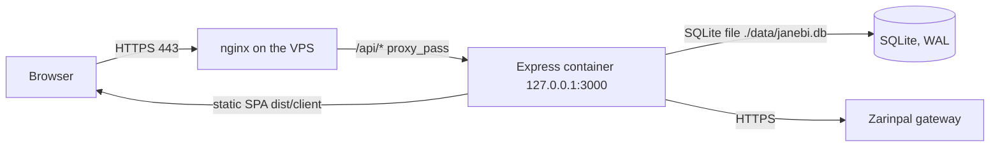

# Deployment baseline — Janebi Store

> **Status:** living · **Updated:** 2026-10-13 · **Scope:** the production runtime, the container, the reverse proxy, environment variables, the deploy and rollback path, and the scheduled jobs on the VPS. Checked against `Dockerfile`, `docker-compose.yml`, `server/env.ts`, `server/app.ts`, `deploy/nginx-janebi-store.conf`, `deploy.sh`, `scripts/ops/` on 2026-10-13.

## 1. Runtime

- Nginx on the VPS terminates TLS and forwards `/api/` to `127.0.0.1:3000`. Port 80 redirects to HTTPS.
- The app listens only on loopback: `docker-compose.yml` publishes `127.0.0.1:3000:3000`.
- `app.set("trust proxy", 1)` (`server/app.ts`) is safe only because nginx overwrites `X-Forwarded-For` and the port stays on loopback.

## 2. Container

- `Dockerfile` is two stages on `node:22-alpine`. The builder runs `npm ci` and `npm run build`, which produces `dist/server.cjs` and `dist/client`. The runner runs `npm ci --omit=dev` and starts `node dist/server.cjs`.
- The image has no `USER` line, so the process runs as root inside the container. A non-root user would be an improvement; it is not in place.
- `docker-compose.yml` defines one service, `app`. It loads `.env`, sets `NODE_ENV=production`, `PORT=3000`, `DATABASE_URL=./data/janebi.db`, and bind-mounts `./dist`, `./data`, `./public/products` and `./public/images`. No PostgreSQL service exists.

## 3. Environment variables

The validated list is in `server/env.ts`; this table shows the core ones with their code defaults.

| Variable | Default in code | Notes |
|---|---|---|
| `PORT` | `3000` | |
| `NODE_ENV` | — | `production` in compose |
| `DATABASE_URL` | `./data/janebi.db` | SQLite file path; a `postgres://` or `postgresql://` value is rejected at startup (`server/db/index.ts`) |
| `JWT_ACCESS_SECRET` | — | at least 10 characters; the placeholder value is rejected in production |
| `JWT_REFRESH_SECRET` | — | at least 10 characters |
| `ZARINPAL_MERCHANT_ID` | — | merchant UUID |
| `ZARINPAL_SANDBOX` | `true` | `false` selects the live gateway |
| `APP_URL` | `http://localhost:3000` | public base URL; used for CORS and callbacks |
| `CORS_ORIGIN` | — | optional allow-list |
| `SMS_API_KEY`, `SMS_TEMPLATE_ID` | — | enable SMS OTP |
| `BALE_BOT_TOKEN`, `BALE_ADMIN_CHAT_IDS` | — | Bale operator bot |
| `GEMINI_API_KEY` | — | optional |

Real values live in the server's `.env` and the gitignored `deploy.env` (holds `VPS_HOST`). They are never written into this repository.

## 4. Deploy path

`deploy.sh` (repository root) runs from a development machine:

1. Requires `VPS_HOST` (from `deploy.env` or the environment).
2. Builds locally, then `rsync`s `dist/`, `drizzle/`, `package.json`, the compose files and `scripts/ops/` to the server.
3. Restarts the `app` service with `docker compose up -d app`, copies the new `server.cjs` and assets into the running container with `docker cp`, and waits for `GET /api/health`.

`scripts/ops/release.sh` makes a hash-sealed release and keeps the previous tree under `releases/prev-<sha>-dist`. It prints a rollback command; it does not run one. `scripts/ops/release-info.mjs` writes the build identity (`BUILD_INFO`) that the served site exposes, so a deployed version can be checked against git.

## 5. Scheduled jobs on the VPS

Installed by `scripts/ops/install-cron.sh`, which is idempotent and must be re-run after any change to `scripts/ops/*`:

- Daily at 02:30: database backup (`scripts/ops/backup-db.mjs`, keeps the last 7 in `./backups`), then verification (`scripts/ops/backup-verify.sh`: snapshot, `integrity_check`, `foreign_key_check`, a real read of rows, then an off-box copy with a Bale alert).
- Every 5 minutes: `scripts/ops/vps-monitor.py` (nginx errors, health, disk, container restarts; alerts through Bale).

The cron entries live on the host and are not in git. Moving a script path without re-running `install-cron.sh` silently stops the job.

## 6. Nginx

- Versioned copy: `deploy/nginx-janebi-store.conf`. `scripts/ops/nginx-drift.sh` compares it with the output of `sudo nginx -T` on the VPS.
- Catalogue endpoints (`/api/products`, `/api/categories`, `/api/brands`, `/api/settings`) are micro-cached for 15 seconds with stale-while-revalidate.
- `deploy/nginx-main.conf` holds the main nginx settings.
